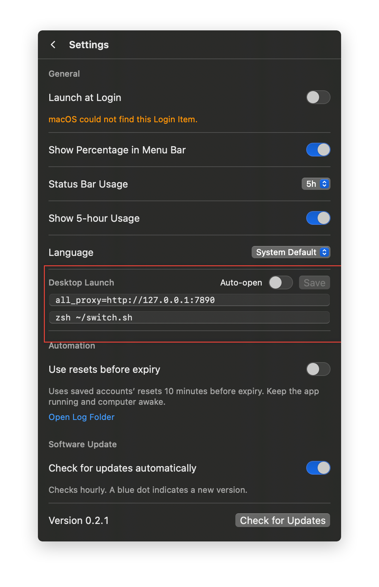

# Codex Account Switcher — macOS fork

English · [中文](README.md)

This fork of [liuzhao1225/codex-account-switcher](https://github.com/liuzhao1225/codex-account-switcher), created by Zhao Liu, adds control over what happens after an account switch on macOS. This README describes the additions in this fork. For the original app's features and full documentation, see the [upstream README](../README.md).

## Download this fork

[Download the macOS development build](https://github.com/MrLoading/codex-account-switcher/releases/download/dev-build/Codex-Account-Switcher-dev.app.zip) · [Download the Windows development build](https://github.com/MrLoading/codex-account-switcher/releases/download/dev-build/Codex-Account-Switcher-windows-x64.exe)

## What this fork adds

<p align="center">
  
</p>

| Addition | Behavior |
| --- | --- |
| **Auto-open switch** | Choose whether to open Codex Desktop after switching accounts. Enabled by default; disable it to leave Desktop closed. |
| **Shell script after switching** | Run an optional script after the selected account is verified and committed. The script runs even with Auto-open disabled and finishes before the launch decision. |
| **Custom environment variables** | Configure variables such as proxy settings for both the script and Desktop launches performed by Switcher. |
| **Source and target account context** | Scripts receive each account's local profile ID, account/workspace ID, email, and display name through environment variables. |
| **Custom-provider identity compatibility** | If an app-server identity response explicitly returns `account: null` and `requiresOpenaiAuth: false`, read the saved ChatGPT identity from the same profile's `auth.json`. Provider configuration is preserved. |

The launch controls are macOS-only. Windows retains the upstream UI and launch behavior.

## Environment and script

Enter environment variables as one `KEY=VALUE` per line, without `export` or shell quoting:

```text
all_proxy=http://127.0.0.1:7890
MY_SETTING=example
```

The script field accepts shell commands, including a command to run an existing file:

```sh
/bin/bash "$HOME/scripts/after-switch.sh"
```

The switch order is:

```text
Close Desktop → save current credentials → activate and verify target
→ commit target → run script → open Desktop if Auto-open is enabled
```

Selecting the current account does nothing. An empty script is skipped. A script failure reports an error and prevents automatic opening; the selected account stays active.

Scripts run through `/bin/zsh -c` with your home directory as the working directory. Before execution, Switcher merges its inherited environment with the configured variables, then sets the reserved account variables and `CODEX_HOME` to the active Codex home. Script `export` statements do not carry back into Desktop; put Desktop variables in the environment field. Scripts have no interactive input or visible stdout/stderr; redirect any desired logs to a file.

## Account variables available to scripts

| Source account | Target account | Value |
| --- | --- | --- |
| `CODEX_SWITCHER_SOURCE_PROFILE_ID` | `CODEX_SWITCHER_TARGET_PROFILE_ID` | Stable local profile UUID. |
| `CODEX_SWITCHER_SOURCE_ACCOUNT_ID` | `CODEX_SWITCHER_TARGET_ACCOUNT_ID` | Account/workspace ID, when available. |
| `CODEX_SWITCHER_SOURCE_EMAIL` | `CODEX_SWITCHER_TARGET_EMAIL` | Email, when available. |
| `CODEX_SWITCHER_SOURCE_NAME` | `CODEX_SWITCHER_TARGET_NAME` | Display name. |

Source values describe the account captured before switching; target values describe the verified, committed account. Missing optional values are empty strings, and all source values are empty on first activation. These reserved values override configured variables and are passed only to the script.

For example, choose an action by target email:

```sh
case "$CODEX_SWITCHER_TARGET_EMAIL" in
  work@example.com) /bin/bash "$HOME/scripts/work-account.sh" ;;
  *) /bin/bash "$HOME/scripts/default-account.sh" ;;
esac
```

## Credits and license

Original project: [Zhao Liu / liuzhao1225](https://github.com/liuzhao1225/codex-account-switcher). This fork retains the upstream [MIT license](../LICENSE) and copyright notice.
